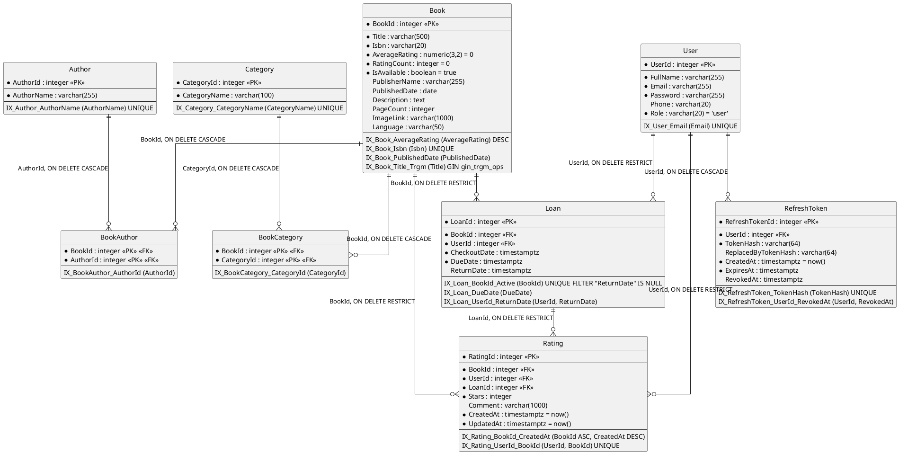

# Lectio Backend

REST API of **Lectio**, a university library app — catalog, authentication, loans and ratings.

## Description

**Lectio** is a university library application. This repository is its backend: an ASP.NET Core Web API that exposes the book catalog (search, category filters, pagination, top-rated lists, details and reviews), user authentication (register, login, rotating refresh tokens, logout), loans (borrow and return) and book ratings.

The API is consumed by **LectioFrontend**, a React + Vite application deployed on Vercel.

A few deliberate decisions: authentication is hand-made on a custom `User` table with BCrypt password hashing and a JWT plus a rotating refresh token, instead of ASP.NET Core Identity, to keep the auth flow explicit and lightweight. Application services use `AppDbContext` directly, without a Repository or Unit of Work layer, because the business rules are simple and EF Core is already the abstraction. Data lives in PostgreSQL on Supabase, with Row Level Security enabled through SQL inside the migrations.

Lectio is the final project of the university course **Desarrollo Web** (Jala University).

## Table of Contents

- [Description](#description)
- [Folder Structure](#folder-structure)
- [Installation and Running](#installation-and-running)
- [How to Use](#how-to-use)
- [Technologies](#technologies)
- [How to Contribute](#how-to-contribute)
- [Design (Figma)](#design-figma)
- [Architecture](#architecture)
- [Database Model](#database-model)
- [License](#license)

## Folder Structure

```text
LectioBackend/
├── Application/                 # Use cases: business rules, services, DTOs and validation
│   ├── Auth/                    # Register, login, refresh-token rotation and logout
│   ├── Books/
│   │   ├── BookDetails/         # Single book detail
│   │   ├── BookRatings/         # A book's reviews/ratings, paginated
│   │   ├── BrowseBooks/         # Catalog search, filters, sorting and pagination
│   │   └── TopRatedBooks/       # Top-rated books, optionally filtered by category
│   ├── Categories/              # Category list with book counts
│   ├── Loans/
│   │   ├── CreateLoan/          # Borrow a book
│   │   ├── LoanStatus/          # Whether a book is currently borrowed
│   │   ├── ReturnLoan/          # Return a book
│   │   └── UserLoans/           # A user's loans, paginated
│   ├── Ratings/
│   │   └── UpsertRating/        # Create or update a rating/review
│   └── Seeding/                 # Seeders for books, users, loans, ratings and categories
│       ├── CategoryTranslation/ # Translate category names
│       ├── LoanSeed/            # Generate and seed loans
│       ├── RatingSeed/          # Generate and seed ratings
│       └── UserSeed/            # Generate and seed users
├── Controllers/                 # HTTP layer: routes, verbs and status codes (thin)
│   ├── AuthController/          # /api/auth
│   ├── BooksController/         # /api/books
│   ├── CategoriesController/    # /api/categories
│   ├── SeederControllers/       # /api/seed (administrator utilities)
│   └── UsersController/         # /api/users (requires a JWT)
├── Domain/                      # Core types, independent from the other layers
│   ├── Entities/                # EF Core entities (Book, Author, User, Loan, ...)
│   └── Exceptions/              # Business-rule exceptions (NotFound, Conflict, ...)
├── Infrastructure/              # Technical details: database and external services
│   ├── Data/                    # AppDbContext
│   │   └── Configurations/      # Fluent API mappings (keys, indexes, relations)
│   ├── ExternalServices/        # Google Books client and in-memory seed state
│   └── Migrations/              # EF Core migrations (the Row Level Security SQL lives here)
├── Middlewares/                 # Exception middleware (application/problem+json)
├── Properties/                  # launchSettings.json (local profiles, ports and URLs)
├── scripts/                     # Documentation scripts (generate/check the handoff docs)
└── .opencode/                   # SDD workflow: constitution, specs, agents and commands
```

Root-level files:

- `Program.cs` — application entry point: dependency injection, authentication, CORS, rate limiting, middleware and endpoints.
- `LectioBackend.csproj` — project file: target framework and NuGet packages.
- `appsettings.json` / `appsettings.Development.json` — configuration (connection string and JWT settings; values come from user-secrets or environment variables).
- `Dockerfile` / `.dockerignore` — container image used for deployment.
- `LectioBackend.http` — sample HTTP requests for manual testing.
- `BACKEND_CONTEXT.md` / `BACKEND_API_CONTEXT.md` / `BACKEND_FILES.md` — handoff documents for reviewers, the frontend and AI agents.
- `seed-progress-*.json` — saved progress of the catalog seeders.
- `opencode.json` / `AGENTS.md` — configuration and rules for the AI-assisted workflow.
- `README.md` — this file.

## Installation and Running

### Prerequisites

- .NET SDK **10** (the project targets `net10.0`).
- A PostgreSQL database (the project is set up for Supabase).
- Git.
- A Google Books API key, only if you want to run the seeders.

### Clone

```bash
git clone https://github.com/StevenBalagueraP/Lectio
cd LectioBackend
```

### Configure

The API reads its configuration from `appsettings.json`, and any key can be overridden with user-secrets or environment variables. The keys below are **required**; never commit their real values.

| Key | Purpose | Example |
| --- | --- | --- |
| `ConnectionStrings:DefaultConnection` | PostgreSQL connection string | `<your-connection-string>` |
| `Jwt:Secret` | HMAC key used to sign the JWTs (at least 32 characters) | `<your-random-secret>` |
| `GoogleBooks:ApiKey` | Google Books API key, needed only to run the seeders | `<your-google-books-key>` |

Set them with user-secrets (a `UserSecretsId` is defined in the project):

```bash
dotnet user-secrets set "ConnectionStrings:DefaultConnection" "<your-connection-string>"
dotnet user-secrets set "Jwt:Secret" "<your-random-secret-32-chars>"
dotnet user-secrets set "GoogleBooks:ApiKey" "<your-google-books-key>"
```

Or with environment variables (use `__` instead of `:`):

```bash
export ConnectionStrings__DefaultConnection="<your-connection-string>"
export Jwt__Secret="<your-random-secret-32-chars>"
```

Optional keys (already present in `appsettings.json` or with a default in the code):

| Key | Purpose |
| --- | --- |
| `Jwt:Issuer` | Issuer that the token must match |
| `Jwt:Audience` | Audience that the token must match |
| `Jwt:AccessTokenMinutes` | Access-token lifetime in minutes (default 15) |
| `Jwt:RefreshTokenDays` | Refresh-token lifetime in days (default 7) |
| `Cors:Origins` | Allowed frontend origin(s) (default `http://localhost:5173`) |
| `AllowedHosts`, `Logging:*` | ASP.NET Core host filtering and logging |

### Create the database schema

The migrations also enable Row Level Security. There is no local tool manifest, so install the EF Core CLI once:

```bash
dotnet tool install --global dotnet-ef
dotnet ef database update
```

### Run

```bash
dotnet run
```

The launch profiles in `Properties/launchSettings.json` listen on:

- `http` — http://localhost:5031
- `https` — https://localhost:7026 and http://localhost:5031

In the Development environment, Swagger UI is available at `/swagger`.

## How to Use

### Swagger UI

In the Development environment the API exposes an interactive Swagger UI at `/swagger` (for example https://localhost:5031/swagger). It documents every endpoint and lets you try them with a Bearer token.

### Authentication flow

1. Create an account with `POST /api/auth/register` (`fullName`, `email`, `password`, optional `phone`) or sign in with `POST /api/auth/login` (`email`, `password`).
2. Both return an `AuthResponseDto` with `accessToken`, `refreshToken`, `tokenType` (`Bearer`), `expiresIn` (seconds) and the `user` (`id`, `fullName`, `email`, `phone`, `role`).
3. Send the access token on protected requests: `Authorization: Bearer <accessToken>`.
4. When the access token expires, call `POST /api/auth/refresh` with `{ "refreshToken": "<refreshToken>" }`. The refresh token is single-use and rotates on every call.
5. Sign out with `POST /api/auth/logout` with `{ "refreshToken": "<refreshToken>" }` (returns `204`).

The access token lasts **15 minutes** and the refresh token **7 days** (both configurable).

### Public and protected areas

The catalog and authentication endpoints are public: `/api/auth/*`, `/api/books/*`, `/api/categories` and `/health`. The `/api/users/*` endpoints (loans and ratings) require a valid JWT, and you can only act on your own user unless you hold the `admin` role.

### Examples

Log in and capture the token:

```bash
curl -X POST https://localhost:7026/api/auth/login \
  -H "Content-Type: application/json" \
  -d '{"email":"<your-email>","password":"<your-password>"}'
```

Call a protected endpoint with that token:

```bash
curl "https://localhost:7026/api/users/1/loans?page=1&pageSize=10" \
  -H "Authorization: Bearer <accessToken>"
```

### Frontend CORS

The frontend must call the API from an origin allowed by the `Cors:Origins` setting; by default only `http://localhost:5173` (the Vite dev server) is allowed.

The seeding endpoints under `/api/seed` are development utilities for administrators: the user, book, loan and rating seeders require the `admin` role.

## Technologies

| Technology | Version | Purpose |
| --- | --- | --- |
| .NET / ASP.NET Core Web API | `net10.0` | Runtime, web framework and controllers |
| BCrypt.Net-Next | 4.2.0 | Password hashing |
| Microsoft.AspNetCore.Authentication.JwtBearer | 10.0.* (resolves to 10.0.12) | JWT bearer authentication |
| Microsoft.AspNetCore.OpenApi | 10.0.9 | OpenAPI document generation |
| Microsoft.EntityFrameworkCore.Design | 10.0.12 | EF Core design-time support for migrations |
| Microsoft.OpenApi | 2.7.5 | OpenAPI object model |
| Npgsql | 10.0.3 | PostgreSQL driver |
| Npgsql.EntityFrameworkCore.PostgreSQL | 10.0.3 | EF Core provider for PostgreSQL |
| Swashbuckle.AspNetCore | 10.2.3 | Swagger UI |
| PostgreSQL on Supabase | — | Database, with Row Level Security enabled in the migrations |
| Google Books API | v1 | Book data source, used only by the seeders |
| Render | — | Backend deployment (Oregon) |

## How to Contribute

1. Fork the repository and clone your fork; create a branch for your change.
2. Make the change following the conventions below.
3. Verify it compiles: `dotnet build --nologo`.
4. Never commit secrets or real `appsettings` values.
5. Open a pull request that explains what changed and why.

Conventions used in this repository:

- Controllers stay thin (routing, status codes) and the business rules live in `Application/` services.
- DTOs are separate from entities and validate their input with DataAnnotations.
- Asynchronous code uses `async`/`await` with the `Async` suffix.
- Nullable reference types are enabled (`<Nullable>enable</Nullable>`).
- Code identifiers and API messages are in English; dates are UTC.
- Schema changes are new EF Core migrations (`dotnet ef migrations add <Name>`), and the Row Level Security SQL is added inside the migration.
- No new NuGet package without discussing it in the pull request.
- ASP.NET Core Identity, Repository/Unit of Work, MediatR and AutoMapper are deliberately not used.

## Design (Figma)

The UI mockups for Lectio are in this Figma file:

https://www.figma.com/design/VWf8Ie1JsaLGxFNFHw4pIY/Web-Development---Book-store-Mock-ups?node-id=0-1&p=f&t=aDfMx0cy5LG7kPe2-0

## Architecture

Lectio Backend is a layered ASP.NET Core Web API. HTTP concerns stay in the controllers, the business rules live in the application services, and data access happens through a single `AppDbContext` built with EF Core (Code First) against PostgreSQL.

| Layer | Folder | Responsibility |
| --- | --- | --- |
| HTTP / Presentation | `Controllers/` | Routing, input binding and HTTP status codes; controllers stay thin |
| Application | `Application/` | Business rules, use cases, DTOs and validation |
| Domain | `Domain/` | Entities and business-rule exceptions, with no dependencies on the other layers |
| Infrastructure | `Infrastructure/` | `AppDbContext`, EF Core mappings, external clients and migrations |
| Cross-cutting | `Middlewares/` | Translates exceptions into `application/problem+json` responses |

Request flow:

```text
Client (LectioFrontend)
   │  HTTPS + JSON
   ▼
ASP.NET Core pipeline
   ├─ Forwarded headers
   ├─ CORS
   ├─ Rate limiter
   ├─ Exception middleware  ──▶  application/problem+json (ProblemDetails)
   ├─ HTTPS redirection
   ├─ Authentication (JWT bearer)
   └─ Authorization
   ▼
Controller (Controllers/)        ← binds input and calls one service
   ▼
Service (Application/)           ← applies business rules, returns DTOs
   ▼
AppDbContext (Infrastructure/)   ← EF Core (Code First)
   ▼
PostgreSQL on Supabase           ← Row Level Security
```

Cross-cutting pieces:

- A single exception middleware answers `application/problem+json` (`ProblemDetails`: `title`, `status`, `detail`, `instance`).
- Authentication is a custom JWT (HS256) plus an opaque, rotating, single-use refresh token stored hashed in the database.
- Dependencies are registered in `Program.cs`; application services are scoped, while the token service is a singleton.
- Rate limiting is enabled globally and with a stricter policy for the auth endpoints.
- Row Level Security is enabled with raw SQL inside the migrations.

Services use `AppDbContext` directly: the Repository and Unit of Work patterns are deliberately not used.

## Database Model

The model below is built from the files in `Infrastructure/Data/Configurations/` (plus the entities in `Domain/Entities/`).



Legend:

- `*` marks a NOT NULL column; a column without it is nullable.
- `<<PK>>` and `<<FK>>` mark primary and foreign keys, and `= value` is a database default.
- The last block inside each entity lists its indexes and unique constraints.

Render it with the PlantUML online server (https://www.plantuml.com/plantuml) or with a PlantUML extension in your editor.

## License

This project is licensed under the MIT license.
