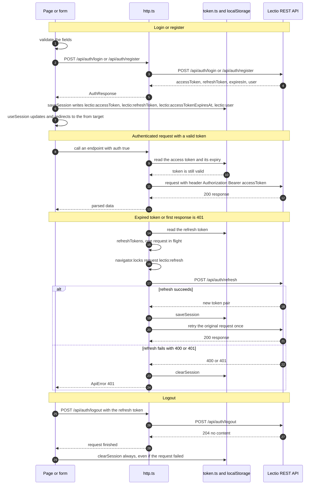

# Lectio Frontend

> Web client of Lectio, a university library app.

## Description

Lectio Frontend is the single-page web client of **Lectio**, a university library app. A reader can see the top-rated books, browse and search the catalogue by title and category, open the detail of a book, borrow and return books, follow the loan history, read and publish reviews, and manage a session (register, log in, view the profile, log out). It is the interface for library users; the course reviewer and the developer also use it to check the end-to-end flow.

It consumes the Lectio REST API (the **LectioBackend** part of the same repository, `https://github.com/StevenBalagueraP/Lectio`) through a single typed base URL. Every screen is backed by a real endpoint: the catalogue, the book detail, the loan status, the loans and the ratings all come from the API, never from static data.

The frontend is a React + TypeScript app built with Vite. The main technical decisions are: strict TypeScript compiled by Vite; CSS Modules with design tokens instead of a CSS framework; a small own `fetch` wrapper (`src/api/http.ts`) plus an own data hook (`src/shared/hooks/useFetch.ts`) instead of a data-fetching library; and the session kept in `localStorage` with automatic token renewal. There is deliberately no global state library (no Redux, Zustand or React Query) and no Axios or UI kit: the state lives in the URL, in local component state and in `useSession()`.

This is the final project of the university course **"Desarrollo Web"** (Jala University), built together with LectioBackend.

## Table of Contents

- [Description](#description)
- [Folder Structure](#folder-structure)
- [Installation and Running](#installation-and-running)
- [How to Use](#how-to-use)
- [Technologies](#technologies)
- [How to Contribute](#how-to-contribute)
- [Design (Figma)](#design-figma)
- [Architecture](#architecture)
- [Authentication Flow](#authentication-flow)
- [Testing](#testing)
- [License](#license)

## Folder Structure

```text
LectioFrontend/
├── .opencode/                     SDD workflow: constitution, agents, commands and feature specs
├── public/                        Static files copied as-is (the logo.png favicon)
├── scripts/                       Node scripts that generate and check the handoff documents
├── src/
│   ├── api/                       Everything that talks to the backend
│   │   ├── endpoints/             One module per resource (auth, books, categories, loans, ratings)
│   │   └── types/                 API types (auth, book, loan, rating, category, common)
│   ├── assets/                    Images imported by components (logo.png)
│   ├── config/                    env.ts, the typed environment variables
│   ├── features/                  One folder per screen
│   │   ├── book-detail/           Book detail page and its components
│   │   ├── book-reviews/          Reviews page, rating summary, review form and review list
│   │   ├── categories/            Catalogue page: search, category and book filters, pagination
│   │   ├── history/               "My Library" loan history page
│   │   ├── home/                  Home page: hero carousel, category shortcuts and top-rated books
│   │   ├── loan/                  Borrow page and the loan error helpers
│   │   ├── login/                 Login page and its validation
│   │   ├── profile/               Profile page, menu and the logout hook
│   │   └── register/              Register page and its validation
│   ├── routes/                    index.tsx (the router) and AppLayout.tsx
│   ├── shared/                    Reused across features
│   │   ├── components/            Buttons, cards, grids, navbar, dialogs and form fields
│   │   ├── hooks/                 useFetch, useSession, useBookDetail, useDebouncedValue and more
│   │   └── utils/                 cache, validation, redirect, apiError and book helpers
│   ├── test/                      Jest setup, the fetch mock and the module mocks
│   ├── index.css                  Design tokens (CSS custom properties) and the global reset
│   └── main.tsx                   React entry point (StrictMode + RouterProvider)
├── AGENTS.md                      Instructions for AI agents working in this repository
├── eslint.config.js               ESLint flat config
├── index.html                     HTML shell that mounts the app and loads the Poppins font
├── jest.babel-import-meta.cjs     Babel plugin that neutralizes import.meta for Jest
├── jest.config.cjs                Jest configuration
├── package.json                   Scripts and dependencies
├── tsconfig.json                  TypeScript project references
├── tsconfig.app.json              TypeScript options for the app sources
├── tsconfig.node.json             TypeScript options for the build config files
├── vercel.json                    SPA fallback rewrite for Vercel
└── vite.config.ts                 Vite configuration
```

## Installation and Running

### Prerequisites

- **Node.js** and **npm**. The project is built with Vite 8, whose engine requirement is `^20.19.0 || >=22.12.0` (read from the installed `vite` package). The repository does not pin a Node version: it has no `.nvmrc`, no `.node-version` and no `engines` field.
- A running **Lectio API** reachable from the browser. By default the app expects it on `http://localhost:5031` (the fallback in `src/config/env.ts`).
- **Git**.

### Clone

```bash
git clone git@github.com:StevenBalagueraP/Lectio.git
cd LectioFrontend
```

### Install

```bash
npm install
```

### Configure

The app reads a single environment variable. It is typed in `src/config/env.ts` and read through `import.meta.env`.

| Variable | Read in | Purpose | Fallback when missing |
| --- | --- | --- | --- |
| `VITE_API_URL` | `src/config/env.ts` | Base URL of the Lectio REST API | `http://localhost:5031` |

Create a `.env` file in the project root with the variable and your own value:

```bash
VITE_API_URL=http://localhost:5031
```

Use the variable name with a placeholder only; never commit real values. The `.env` file is ignored by Git (the rule lives in the repository root `.gitignore`).

### Run

```bash
npm run dev
```

Vite serves the app on its default port `5173`, because `vite.config.ts` sets no custom port, alias or proxy.

### Build and Preview

```bash
npm run build
npm run preview
```

`npm run build` runs the TypeScript build (`tsc -b`) and then `vite build`, producing the static bundle in `dist/`. `npm run preview` serves that bundle locally.

### Deploy

The project is deployed on **Vercel**. `vercel.json` rewrites every path to `index.html` so that client-side routing works on a deep link or after a refresh (SPA fallback).

### Quality checks

```bash
npm run lint
npm test
```

## How to Use

The router lives in `src/routes/index.tsx`. All screens share `AppLayout`, which renders the `Navbar` and the routed page.

| Path | Screen | What the user can do | Needs a session |
| --- | --- | --- | --- |
| `/` | Home | See the most-visited books in a carousel, pick a category shortcut and open a book | No |
| `/categories` | Categories | Search by title, filter by categories and book filters, paginate and open a book | No |
| `/books/:bookId` | Book detail | Read the summary and basic info, go to the reviews, borrow the book or return it | Only to borrow or return |
| `/books/:bookId/loan` | Borrow | Review the checkout and due dates and confirm the loan | Yes (redirects to `/login`) |
| `/books/:bookId/reviews` | Reviews | Read the average rating and the reviews, and publish a review | Only to publish a review |
| `/history` | History ("My Library") | See the loans with their status and paginate; return or rate a book | Yes (redirects to `/login`) |
| `/login` | Login | Sign in with email and password | No (redirects away when already signed in) |
| `/register` | Register | Create an account with full name, email, optional phone and password | No (redirects away when already signed in) |
| `/profile` | Profile | See the user's name and the menu, and log out | Yes (redirects to `/login`) |

Main user flows:

1. **Browse and search.** Open the home page, follow a category shortcut, or go to `/categories` to search by title and combine category and book filters; the filters and the page number are kept in the URL.
2. **Open a book.** From any grid, open `/books/:bookId` to read the summary and the basic info, and jump to its reviews.
3. **Borrow.** From the book detail, press the loan button; a signed-in user reaches `/books/:bookId/loan` and confirms the loan, which posts to the API with the checkout and due dates.
4. **Return and rate.** From `/history`, return a borrowed book (which opens the book detail with a confirmation dialog) or go to its reviews to rate it.
5. **Write a review.** On `/books/:bookId/reviews`, a signed-in user opens the review form, picks a rating from 1 to 5, adds an optional comment and submits it.
6. **Register and log in.** Create an account on `/register` or sign in on `/login`; on success the session is saved and the app returns to the page the user came from.
7. **Log out.** From `/profile`, log out; the local session is cleared and the protected screens stop being reachable.

When a signed-out user tries a protected action, the app sends them to `/login` and remembers the original page, so the redirect points back there after signing in. Every piece of data shown on these screens comes from the API configured in `VITE_API_URL`.

## Technologies

### Runtime dependencies

| Technology | Version | Purpose |
| --- | --- | --- |
| react | ^19.2.8 | UI library (function components and hooks) |
| react-dom | ^19.2.8 | React renderer for the browser |
| react-icons | ^5.7.0 | Icon set (Material Design icons) |
| react-router | ^8.4.0 | Client-side routing with a data router |

### Development tooling

| Technology | Version | Purpose |
| --- | --- | --- |
| vite | ^8.3.0 | Dev server and production build |
| @vitejs/plugin-react | ^6.1.1 | React plugin for Vite (Fast Refresh) |
| typescript | ~6.0.2 | Type checking (strict) |
| @types/react | ^19.2.18 | React type definitions |
| @types/react-dom | ^19.2.7 | React DOM type definitions |
| @types/node | ^24.13.3 | Node type definitions for the config files |
| jest | ^30.5.2 | Test runner |
| jest-environment-jsdom | ^30.5.2 | JSDOM test environment |
| babel-jest | ^30.5.2 | Compiles TS/TSX for Jest |
| @babel/core | ^8.0.7 | Babel core used by babel-jest |
| @babel/preset-env | ^8.0.7 | Babel preset for the current Node target |
| @babel/preset-react | ^8.0.1 | Babel preset for JSX |
| @babel/preset-typescript | ^8.0.7 | Babel preset for TypeScript |
| @testing-library/react | ^16.3.3 | Render and query React components |
| @testing-library/dom | ^10.4.2 | DOM queries used by the library |
| @testing-library/user-event | ^14.6.7 | Realistic user interactions |
| @testing-library/jest-dom | ^7.0.1 | DOM matchers such as `toBeInTheDocument` |
| @types/jest | ^30.0.0 | Jest type definitions |
| identity-obj-proxy | ^3.0.0 | Mocks CSS Modules in Jest |
| eslint | ^10.10.0 | Linter |
| @eslint/js | ^10.0.1 | ESLint recommended rules |
| typescript-eslint | ^8.69.0 | TypeScript rules for ESLint |
| eslint-plugin-react-hooks | ^7.1.1 | React hooks lint rules |
| eslint-plugin-react-refresh | ^0.5.6 | React Refresh lint rules |
| globals | ^17.12.0 | Browser globals for ESLint |

### Also used

- **CSS Modules** (`Name.module.css` per component) with design tokens as CSS custom properties in `src/index.css`.
- **Google Fonts**: the **Poppins** family (weights 400, 500, 600 and 700), loaded with a `<link>` in `index.html`.
- **Vercel** for deployment, with the SPA fallback in `vercel.json`.

## How to Contribute

Recommended workflow:

1. Fork the repository and clone your fork.
2. Create a branch with a clear name (`feature/...` or `fix/...`).
3. Make the change, keeping the existing conventions (see below).
4. Run the checks before opening a pull request:

   ```bash
   npm run build
   npm run lint
   npm test
   ```

5. Never commit `.env` values, tokens or passwords.
6. Open a pull request and explain what it changes and why.

Conventions that exist in this codebase:

- **Components** use named exports (`export function Name(props)`) and the props interface is declared locally as `interface NameProps` (`src/shared/components/Button/Button.tsx`).
- **One folder per component**, holding `Name.tsx` and `Name.module.css` (`src/shared/components/BookGrid/`).
- **`import type`** for type-only imports and **no `enum` or `namespace`**, because `tsconfig.app.json` enables `verbatimModuleSyntax` and `erasableSyntaxOnly`.
- **Design tokens instead of hard-coded colors**: colors, spacing, radius and font sizes come from `src/index.css` as `var(--...)`. A grep for color literals in the `*.module.css` files finds only two exceptions, both a plain `#111` background in `src/features/home/components/HeroCarousel/HeroCarousel.module.css`.
- **API access only through `src/api/`**: every call goes through `http<T>()` in a module of `src/api/endpoints/`, with types in `src/api/types/`; no component calls `fetch` directly.
- **Pages navigate and components do not**: pages use the router and the hooks; presentational components receive data and callbacks by props.
- **`shared/` never imports from `features/`** (checked by `.opencode/sdd/features/001-create-readme/check-layers.mjs`).
- **New packages** should be discussed in the pull request, because the project keeps its dependency list small.

## Design (Figma)

The UI mock-ups live in Figma:

https://www.figma.com/design/VWf8Ie1JsaLGxFNFHw4pIY/Web-Development---Book-store-Mock-ups?node-id=0-1&p=f&t=aDfMx0cy5LG7kPe2-0

## Architecture

The app is a client-side single-page application. It renders routes with `react-router`, fetches data through a thin API layer, and keeps the session in `localStorage`.

| Layer | Folder | Responsibility |
| --- | --- | --- |
| API | `src/api/` | Builds requests, attaches the token, renews the session, parses errors and maps responses to typed models |
| Config | `src/config/` | Reads the environment variables (`env.ts`) |
| Features | `src/features/` | One folder per screen: pages, local components, hooks and helpers |
| Routes | `src/routes/` | The router definition and the shared `AppLayout` |
| Shared | `src/shared/` | Components, hooks and utilities reused by several features |
| Test | `src/test/` | Jest setup, the fetch mock and the module mocks |

Data flow when reading:

```text
Page (src/features/<feature>/pages/...Page.tsx)
  -> feature hook (hooks.ts) or a shared hook (src/shared/hooks/)
  -> useFetch (src/shared/hooks/useFetch.ts, in-memory cache + TTL + AbortController)
  -> endpoint (src/api/endpoints/)
  -> http (src/api/http.ts)
  -> fetch to the API base URL from src/config/env.ts
```

Data flow when writing (borrow, return, review):

```text
Page
  -> endpoint (src/api/endpoints/, with auth true where a session is required)
  -> http (src/api/http.ts, attached token)
  -> local useState for the submitting flag and the error/notice messages
```

Cross-cutting pieces:

- **`ApiError`** (`src/api/http.ts`) carries the HTTP status and the server message; helpers such as `getApiErrorMessage`, `getLoanErrorMessage` and `getSubmitErrorMessage` turn it into user text.
- **`useFetch`** keeps an in-memory cache with a TTL, de-duplicates in-flight requests and aborts on unmount; a persisted variant writes to `localStorage` under the `lectio:cache:` prefix (`src/shared/utils/cache.ts`).
- **Session**: `src/api/token.ts` stores the tokens and the user in `localStorage` and notifies listeners; `useSession()` exposes the user to the UI through `useSyncExternalStore` and also reacts to changes in other tabs.
- **State** lives in local component state, in `useSession()` and in the URL (the catalogue filters and page are query parameters, `src/features/categories/pages/CategoriesPage.tsx`). There is no global store.
- **Styling** is mobile-first CSS Modules with the design tokens of `src/index.css`.

Layer rules and the current result:

- `shared/` must not import from `features/`; features must not import each other; `api/` may import only from `config/` and itself.
- Running `node .opencode/sdd/features/001-create-readme/check-layers.mjs` today **reports one violation**: `src/features/book-detail/pages/BookDetailPage.tsx` imports `../../loan/utils` (`features/book-detail` importing from `features/loan`). It is reported here and not fixed, because this feature only rewrites the README.

Libraries deliberately not used (verified absent in `package.json`): Tailwind, Redux, Zustand, React Query, Axios, `createContext`/`useContext`, styled-components and any UI or form library.

## Authentication Flow

Authentication uses a **token pair**: a short-lived access token and a single-use rotating refresh token, both kept in `localStorage`. `src/api/http.ts` sends the access token on protected requests and renews the pair automatically when it is about to expire or when a request fails with `401`. The user object is stored next to the tokens.

Storage keys (names and purpose only, values never documented; defined in `src/api/token.ts`):

| Key | Purpose |
| --- | --- |
| `lectio:accessToken` | The current access token sent in the `Authorization` header |
| `lectio:refreshToken` | The rotating refresh token used to renew the session |
| `lectio:accessTokenExpiresAt` | The access token expiry timestamp, used to decide when to renew |
| `lectio:user` | The serialized user shown by `useSession()` |

Auth endpoints (defined in `src/api/endpoints/auth.ts` and `src/api/http.ts`):

| Method | Path | Request fields | Response |
| --- | --- | --- | --- |
| POST | `/api/auth/login` | `email`, `password` | The token pair and the user |
| POST | `/api/auth/register` | `fullName`, `email`, `password`, `phone` | The token pair and the user |
| POST | `/api/auth/refresh` | `refreshToken` | A new token pair, saved with `saveSession` |
| POST | `/api/auth/logout` | `refreshToken` | No content (`204`) |

The renewal lock is named `lectio:refresh` and is taken through `navigator.locks.request`.



### Login and registration

`LoginPage` and `RegisterPage` validate before sending: the login form requires a well-formed email and a non-empty password, and the register form requires a name of at least 2 characters, a valid email, a password of 8 to 72 characters with at least one letter and one digit, and an optional phone. On submit they call `login` or `register` from `src/api/endpoints/auth.ts` and, on success, `saveSession(auth)` writes the four storage keys. A user who is already signed in is redirected away from both pages through `getRedirectTarget`. Error messages come from `getApiErrorMessage`, which shows the server message for client errors (status below 500) and a generic message otherwise.

### Authenticated requests and automatic renewal

Protected requests pass `auth: true` to `http`. Before sending, `getValidAccessToken` checks the stored expiry: if the access token is missing or within the margin (30 seconds, `EXPIRY_MARGIN_MS` in `src/api/token.ts`) of expiring, it renews first. Renewal is de-duplicated with a single in-flight promise and serialized across tabs with the `lectio:refresh` lock, so only one refresh runs at a time; if another tab already replaced the refresh token, the current tab simply reuses the new one. If a request still returns `401`, `http` tries one single refresh and one retry; if the refresh fails with `400` or `401`, the session is cleared.

### Logout

`useLogout` (`src/features/profile/hooks.ts`) reads the refresh token, calls `logout` and, in a `finally` block, always runs `clearSession`. The local session is cleared even when the request fails or there is no network. The tokens already stored are simply removed from `localStorage`.

### Protected screens and redirects

`/history`, `/profile` and the loan page (`/books/:bookId/loan`) require a session. Without one they send the user to `/login` and pass a `from` value in the router state (`/history`, `/profile` and `/books/:bookId` respectively). Actions inside public pages follow the same rule: the loan button on the book detail, "Add Review" on the reviews page, and the borrow button redirect to `/login` with the current path as `from`. After a successful login or register, `getRedirectTarget` reads `from` and returns the user there; it only accepts internal paths (a string starting with `/` but not `//`), otherwise it falls back to `/`.

### Session in the UI

`useSession()` wraps `useSyncExternalStore` over `subscribeSession` and `getStoredUser`. `saveSession` and `clearSession` notify the listeners, and `subscribeSession` also listens to the browser `storage` event, so the navbar, the protected screens and every other consumer update immediately, including in another tab.

### Limits

The frontend only removes the tokens from `localStorage`; it does not force the server to invalidate an already issued access token beyond sending the logout request with the refresh token. Validation is a client-side convenience: the API remains the final authority.

## Testing

### Tools

| Tool | Version | Purpose |
| --- | --- | --- |
| jest | ^30.5.2 | Test runner, mocks and coverage |
| jest-environment-jsdom | ^30.5.2 | Browser-like environment |
| @testing-library/react | ^16.3.3 | Render components and pages |
| @testing-library/user-event | ^14.6.7 | Realistic user interactions |
| @testing-library/jest-dom | ^7.0.1 | DOM matchers |
| babel-jest | ^30.5.2 | Compiles TypeScript and TSX for Jest |
| identity-obj-proxy | ^3.0.0 | Mocks CSS Modules |

### How to run

```bash
npm test
npm run test:watch
npm run test:coverage
```

To filter by file or test name:

```bash
npm test -- Pagination
npm test -- --testNamePattern="shows an error"
```

### Test structure

```text
src/
├── test/                                        Shared test infrastructure
│   ├── setupTests.ts                            jest-dom + localStorage cleanup
│   ├── mockFetch.ts                             jsonResponse / emptyResponse / mockFetch helpers
│   ├── envMock.ts                               Mock of import.meta.env for Jest
│   ├── polyfills.ts                             Polyfills needed by JSDOM
│   ├── styleMock.ts                             Mock of plain CSS files
│   └── cookieEsMock.ts                          Mock of cookie-es (an ESM dependency of react-router)
├── shared/
│   ├── components/BookGrid/Bookgrid.test.tsx
│   ├── components/Pagination/Pagination.test.tsx
│   ├── components/RatingStars/RatingStars.test.tsx
│   ├── hooks/useFetch.test.ts
│   └── hooks/useDebouncedValue.test.ts
└── features/
    ├── book-detail/components/LoanButton/Loanbutton.test.tsx
    ├── book-reviews/components/ReviewForm/Reviewform.test.tsx
    ├── book-reviews/pages/BookReviewsPage.test.tsx
    ├── categories/pages/CategoriesPage.test.tsx
    └── login/
        ├── validation.test.ts
        └── pages/LoginPage.test.tsx
```

### Suites

| Suite | Type | What it covers | Tests |
| --- | --- | --- | --- |
| `Bookgrid.test.tsx` | Unit | `BookGrid`: error, empty and loading states, one card per book, cover URL, `onOpen` | 9 |
| `Pagination.test.tsx` | Unit | `Pagination`: hidden for one page, disabled arrows, `aria-current`, `onChange`, ellipsis | 11 |
| `RatingStars.test.tsx` | Unit | `RatingStars`: accessible label, clamping to 0–5, decimals and the large size | 8 |
| `useFetch.test.ts` | Unit | `useFetch`: loading to data, abort signal, error message, `enabled`, in-flight de-duplication, TTL and stale fallback | 10 |
| `useDebouncedValue.test.ts` | Unit | `useDebouncedValue` with fake timers: initial value, delay, reset and cleanup | 6 |
| `Loanbutton.test.tsx` | Unit | `LoanButton`: label and state per loan status, disabled while loading, error state and `onAction` | 9 |
| `Reviewform.test.tsx` | Unit | `ReviewForm`: rating required, submit with stars and comment, character limit and `onCancel` | 12 |
| `BookReviewsPage.test.tsx` | Integration | The reviews page with the real router and hooks; only `fetch` is mocked | 10 |
| `CategoriesPage.test.tsx` | Integration | The catalogue page: list, count, error, empty state, filters and navigation | 10 |
| `validation.test.ts` | Unit | `isValidEmail` and `validateLogin` | 14 |
| `LoginPage.test.tsx` | Integration | The login form: fields, validation, 401, 500, success redirect and in-flight state | 8 |

### Authentication tests

The suites that exercise the session and the login form, by their real titles:

- `LoginPage (integration) shows inline validation errors when submitting with empty fields`
- `LoginPage (integration) shows a server error message when the backend responds with 401`
- `LoginPage (integration) redirects to / after a successful login`
- `LoginPage (integration) shows "Logging in…" while the request is in flight`
- `BookReviewsPage (integration) sends a logged-out user to /login when pressing "Add Review"`
- `BookReviewsPage (integration) lets a logged-in user publish a review and then refreshes the list`
- `BookReviewsPage (integration) asks the user to log in again when the session expired (401)`

### Results

A real run of `npm test` (2026-10) reports **11 passed of 11 test suites** and **107 passed of 107 tests**.

A real run of `npm run test:coverage` reports:

| Metric | Result |
| --- | --- |
| Statements | 80.35% |
| Branches | 72.68% |
| Functions | 81.03% |
| Lines | 84.26% |

Coverage only measures the files that the tests load, because `jest.config.cjs` does not set `collectCoverageFrom`. The most relevant auth files report: `api/http.ts` 45.9% statements (48.97% lines), `api/token.ts` 78.26% statements (79.06% lines), `LoginPage.tsx` 96.66% statements (100% lines) and `useSession.ts` 100%. The session renewal in `src/api/http.ts` is the least covered part of the authentication flow.

### Conventions

- **`fetch` is mocked**: `src/test/mockFetch.ts` replaces `globalThis.fetch` with a `jest.fn()` and provides `jsonResponse` and `emptyResponse`. `clearMocks: true` in `jest.config.cjs` resets it between tests.
- **`localStorage` is cleaned** in an `afterEach` in `src/test/setupTests.ts`; the same file sets `window.scrollTo` and loads the jest-dom matchers.
- **The in-memory cache is isolated** between tests because `src/shared/utils/cache.ts` keeps a module-level `Map`. Integration suites use a unique cache key per test: a different `bookId` in `BookReviewsPage.test.tsx` and a different `page` query parameter in `CategoriesPage.test.tsx`.
- **Fake timers** are used in `useDebouncedValue.test.ts` to control the debounce delay.
- CSS Modules are mocked with `identity-obj-proxy`, `import.meta.env` is mapped to `src/test/envMock.ts` and `cookie-es` to `src/test/cookieEsMock.ts`, all in `jest.config.cjs`.

## License

This project is licensed under the MIT license.
